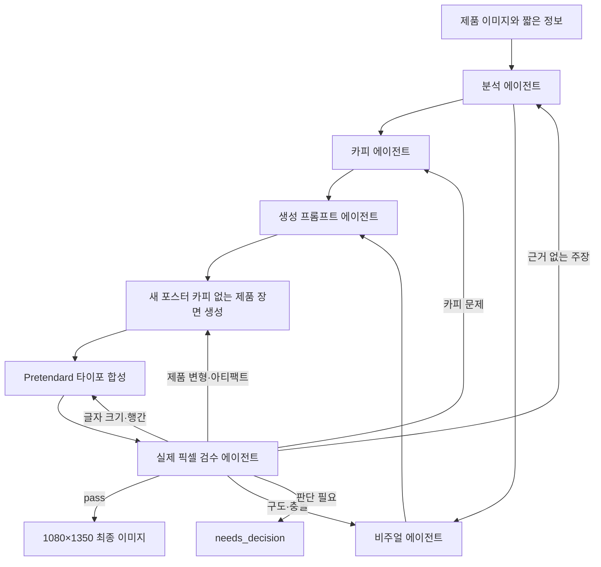

# Instagram Product Poster Skill

제품 이미지와 짧은 정보만으로 포스터형 Instagram 4:5 피드를 만드는 Codex 스킬입니다.

분석, 카피, 비주얼, 생성 프롬프트, 검수 역할을 분리합니다. 이미지 모델에는 새 포스터 카피를 맡기지 않고 기존 제품 라벨만 보존하게 합니다. 배경과 제품 장면은 이미지 생성으로 만들고, 최종 카피는 라이선스가 포함된 Pretendard로 합성합니다.

## 사용 예시

제품 이미지를 첨부한 뒤 다음처럼 요청합니다.

```text
제품명: DEWDROP SERUM
특징: 산뜻한 수분감
인스타 피드 시작하자
```

`인스타 피드 시작하자` 및 의미가 같은 직접 표현(`인스타그램 피드 시작하자`, `제품 포스터 시작하자`)은 빠른 자동 모드를 켭니다. 그 외 요청은 두 번의 승인 단계를 사용하는 guided mode로 동작합니다.

## 처리 구조



## 설치

Codex에서 이 저장소의 스킬을 설치해 달라고 요청하거나 다음 도구를 사용할 수 있습니다.

```bash
python3 ~/.codex/skills/.system/skill-installer/scripts/install-skill-from-github.py \
  --repo kitt-ai-com/creating-instagram-product-posters \
  --path skills/creating-instagram-product-posters

python3 -m pip install -r \
  ~/.codex/skills/creating-instagram-product-posters/requirements.txt
```

이미 같은 이름의 스킬이 설치되어 있으면 기존 디렉터리를 백업하거나 제거한 뒤 다시 설치해야 합니다.

## 테스트

```bash
python3 -m pip install -r skills/creating-instagram-product-posters/requirements.txt
python3 -m unittest -v tests/test_compose_poster.py
```

## 핵심 원칙

- 제품 이미지의 실루엣, 비율, 라벨, 로고, 색상을 보존합니다.
- 사용자가 제공하지 않은 성분, 효능, 인증, 가격, 할인 정보를 만들지 않습니다.
- 이미지 모델이 포스터 카피를 렌더링하지 않게 합니다.
- 작은 메타데이터도 사용자가 문구를 제공하거나 승인한 경우에만 합성하며, 고정 문구를 자동 삽입하지 않습니다.
- 제품 사실인 `feature`와 화면용 메타문구 `feature_text`를 분리합니다.
- Pretendard처럼 상업적 이용이 가능한 번들 폰트만 사용합니다.
- 한글 두 줄 제목은 기본 `--title-spacing 10`을 사용하고 270×338 축소본에서 다시 확인합니다.
- 검수 실패 시 문제가 생긴 단계만 다시 실행하며 자동 수정은 최대 두 번입니다.
- 4:5는 이 스킬의 내부 기본값이며 Instagram 전체 기능의 필수 제한을 뜻하지 않습니다.

## 문서

- [강의안: 제품 이미지에서 Instagram 포스터까지](docs/강의안.md)
- [스킬 본문](skills/creating-instagram-product-posters/SKILL.md)
- [에이전트 역할 계약](skills/creating-instagram-product-posters/references/role-contracts.md)
- [아트 디렉션](skills/creating-instagram-product-posters/references/art-direction.md)

## 폰트 라이선스

번들 Pretendard 폰트는 SIL Open Font License 1.1을 따릅니다. 원문과 출처 정보는 `skills/creating-instagram-product-posters/assets/fonts/`에 포함되어 있습니다.
