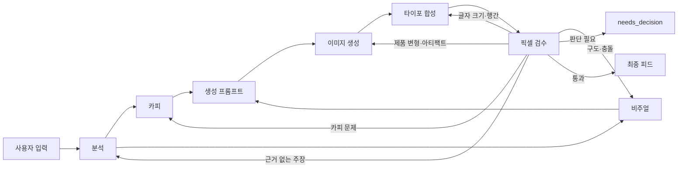

# 제품 이미지 한 장으로 Instagram 포스터 제작하기

## 강의 개요

- 대상: 생성형 AI로 마케팅 이미지를 만들고 싶은 기획자, 디자이너, 개발자
- 권장 시간: 50~60분
- 결과물: 제품 이미지와 간단한 정보에서 1080×1350 포스터형 피드 한 장 제작
- 핵심 메시지: **창의적인 생성과 정확한 타이포그래피를 분리하면 결과의 품질과 재현성이 함께 올라간다.**

## 학습 목표

수강생은 강의 후 다음을 설명하고 실행할 수 있습니다.

1. 이미지 제작 과정을 여러 에이전트 역할로 나누는 이유
2. 제품 정보에서 사실과 창작 가정을 분리하는 방법
3. 이미지 모델에는 장면만 맡기고 글자는 후처리하는 이유
4. 상업적 이용이 가능한 폰트를 안전하게 번들하는 방법
5. 실제 픽셀과 모바일 축소본을 기준으로 검수·수정하는 방법

## 1. 문제 정의

입력은 단순합니다.

- 제품 이미지 1장
- 제품명과 사실에 근거한 특징 1개
- 선택 사항: 타깃, 분위기, 정확한 제목과 서브타이틀

출력은 이 스킬이 내부 기본값으로 사용하는 Instagram 세로형 4:5 이미지입니다. 이는 Instagram 전체 기능의 필수 제한을 뜻하지 않습니다.

- 크기: 1080×1350
- 포스터형 제목과 서브타이틀
- 제품이 중심이 되는 에디토리얼 장면
- 상업적 이용이 가능한 무료 폰트
- 최종 픽셀 검수 결과

제품 정보가 부족할 때 성분, 효능, 인증, 가격, 할인, 재고를 임의로 만들지 않는 것이 첫 번째 원칙입니다.

## 2. 왜 단일 프롬프트가 아니라 에이전트 파이프라인인가

한 번의 프롬프트에 분석, 카피, 디자인, 생성, 검수를 모두 넣으면 각 단계의 오류 원인을 찾기 어렵습니다. 역할을 분리하면 문제가 생긴 단계만 다시 실행할 수 있습니다.



### 다섯 가지 역할

| 역할 | 책임 | 하면 안 되는 일 |
|---|---|---|
| 분석 | 사실, 가정, 보존 요소, 금지 요소 정리 | 광고 카피나 효능을 발명하기 |
| 카피 | 짧은 제목과 서브타이틀 작성 | 새 제품 주장 추가하기 |
| 비주얼 | 구도, 재질, 빛, 팔레트, 타이포 존 설계 | 제품 라벨·로고를 재설계하기 |
| 생성 프롬프트 | 카피와 비주얼을 이미지 생성 명세로 통합 | 승인된 카피를 바꾸거나 이미지를 직접 생성하기 |
| 검수 | 실제 픽셀에서 제품·카피·가독성 확인 | 문제를 직접 고쳐 책임 단계를 숨기기 |

## 3. 입력을 구조화하는 분석 단계

분석 에이전트는 자유로운 문장을 공용 브리프로 바꿉니다. 핵심 필드만 발췌하면 다음과 같습니다.

```yaml
product_name: ""
feature: ""
facts: []
assumptions: []
must_keep: []
must_avoid: []
```

여기서 중요한 구분은 `facts`와 `assumptions`입니다.

- 이미지 라벨에서 읽힌 제품명과 SPF 표기는 사실입니다.
- 타깃을 성인 스킨케어 관심층으로 정한 것은 가정입니다.
- 제품의 효능을 추정하는 것은 허용되지 않습니다.

## 4. 카피와 비주얼을 병렬로 설계하기

분석된 하나의 브리프에서 카피와 비주얼을 동시에 만듭니다.

카피의 기준:

- 한 화면에서 바로 읽히는 짧은 제목
- 제목보다 분명히 작은 서브타이틀
- 원문에 없는 성능 주장 금지
- 사용자가 준 정확한 문구는 글자 단위로 보존
- `eyebrow`, `feature_text`, `footer` 같은 작은 메타데이터는 사용자가 정확한 문구를 제공하거나 승인한 경우에만 사용
- 제품 사실인 `feature`를 화면용 `feature_text`로 자동 복사하지 않음

비주얼의 기준:

- 제품이 화면의 주인공이어야 함
- 표면의 질감, 방향성 있는 빛, 의도적인 그림자 사용
- 중앙 제품과 단색 그라디언트만 있는 카탈로그 구도 지양
- 화면의 25~35%를 타이포그래피 공간으로 예약

권장 장면 유형은 `framed encounter`, `material landscape`, `editorial macro` 중 하나입니다.

## 5. 이미지 생성과 글자 합성을 분리하기

이 파이프라인의 핵심 설계입니다.

### 이미지 모델이 담당하는 것

- 제품이 놓인 장면
- 빛과 그림자
- 재질과 깊이
- 제품 중심의 구도
- 글자가 들어갈 여백
- 새 포스터 카피는 생성하지 않되 원래 제품 라벨 텍스트는 보존

### 결정론적 합성기가 담당하는 것

- 정확한 한글 제목과 서브타이틀
- 폰트 파일 선택
- 크기, 위치, 대비, 줄간격
- 1080×1350 최종 출력

이미지 모델에게 포스터 문구까지 맡기면 오탈자와 글자 변형이 생기기 쉽습니다. 장면은 생성하고 글자는 코드로 합성하면 카피를 문자 단위로 보존할 수 있습니다.

## 6. 폰트 정책

이 스킬은 번들된 폰트만 허용합니다.

- 기본 폰트: Pretendard Bold / Regular
- 라이선스: SIL Open Font License 1.1
- 폰트 파일과 라이선스 파일을 함께 보관
- 시스템 폰트나 이름만 비슷한 대체 폰트 사용 금지

합성기는 허용 목록 밖의 폰트 경로를 거부합니다. 이는 프롬프트 지침이 아니라 코드로 강제되는 정책입니다.

### 합성 실행 예시

이미지 생성에는 Codex의 `imagegen`을 사용할 수 있는 환경이 필요합니다. 아래 명령은 **이 저장소를 체크아웃한 루트 디렉터리에서 실행하는 예시**입니다. 설치된 스킬을 사용할 때는 현재 작업 폴더가 아니라 로드된 `SKILL.md`가 있는 디렉터리를 `skill_root`로 해석해야 합니다. 새 포스터 카피가 없는 장면이 `scene.png`로 준비되었다면 다음처럼 합성합니다.

```bash
python3 -m pip install -r skills/creating-instagram-product-posters/requirements.txt
python3 skills/creating-instagram-product-posters/scripts/compose_poster.py \
  --background scene.png \
  --output poster.png \
  --title $'한 방울의\n수분 루틴' \
  --subtitle '가볍게 스며드는 데일리 세럼' \
  --title-spacing 10
```

## 7. 모바일 타이포그래피 검수

데스크톱에서 괜찮아 보여도 Instagram 피드에서는 작은 크기로 표시됩니다. 따라서 두 크기를 모두 확인합니다.

1. 원본 1080×1350에서 크롭, 대비, 제품 라벨 확인
2. 270×338 축소본에서 제목과 서브타이틀의 즉시 가독성 확인
3. 두 줄 한글 제목은 기본 `--title-spacing 10`에서 시작
4. 위아래 글자 박스가 닿거나 겹치면 행간만 수정

행간만 문제라면 분석, 카피, 이미지 생성을 다시 하지 않습니다.

```text
기존 장면 유지
→ 동일 카피 유지
→ --title-spacing 값만 조정
→ 합성 재실행
→ 전체 크기와 모바일 축소본 재검수
```

이 방식은 수정 범위를 줄이고 제품 이미지의 불필요한 변형을 막습니다.

## 8. 검수와 수정 라우팅

검수 에이전트는 실제 렌더링된 픽셀을 보고 `pass`, `revise`, `needs_decision` 중 하나를 반환합니다.

| 발견된 문제 | 담당 단계 | 다시 실행할 범위 |
|---|---|---|
| 근거 없는 주장 | 분석 | 분석 이후 전체 |
| 승인 전 또는 fast-mode 기록 전 카피가 길거나 약함 | 카피 | 카피 이후 |
| 승인된 원문에 의심되는 오탈자·표현 문제 | 사용자 | `needs_decision` 반환 |
| 장면이 밋밋하거나 충돌함 | 비주얼 | 비주얼 이후 |
| 제품 변형·아티팩트 | 이미지 생성 | 생성과 검수 |
| 렌더된 카피 불일치·크롭·폰트·크기·행간 | 합성 | 합성과 검수만 |

자동 수정은 최대 두 번입니다. 해결되지 않는 차단 이슈는 억지로 통과시키지 않고 `needs_decision`으로 돌려줍니다.

`pass` 전에 다음 차단 항목을 모두 확인합니다.

- 제품이 입력 이미지와 일치하며 주요 라벨이 잘리거나 가려지지 않음
- 제목과 서브타이틀이 승인 문구와 문자 단위로 일치함
- 허용된 번들 폰트와 라이선스 파일이 사용됨
- 추가 포스터 문구, 워터마크, 무관한 로고가 없음
- 제품 패키지 변형이나 아티팩트가 없음
- 모바일 축소본에서도 위계와 대비가 유지됨

## 9. 빠른 자동 모드와 guided mode

### 빠른 자동 모드

제품 이미지와 정보에 `인스타 피드 시작하자`를 붙입니다.

```text
제품명: DEWDROP SERUM
특징: 산뜻한 수분감
인스타 피드 시작하자
```

이 문구는 한 작업에 대한 사전 승인으로 처리되어 중간 확인 없이 최종 이미지까지 진행합니다. 제품 사실 누락, 근거 없는 주장, 안전 문제, 필수 도구 사용 불가, 또는 `needs_decision` 결과가 있으면 멈춥니다.

### Guided mode

실행 신호가 없으면 다음 두 지점에서 확인합니다.

1. 분석 브리프 승인
2. 최종 카피와 비주얼 방향 승인

## 10. 현재 회귀 테스트가 고정하는 동작

현재 테스트는 다음 동작을 고정합니다.

1. 허용 목록 밖 폰트 거부
2. Pretendard 파일과 라이선스 파일의 존재 및 정상 검증
3. 1080×1350 RGB 출력
4. 하단 타이포 배치와 전달된 선택형 에디토리얼 메타데이터의 렌더링
5. `--subtitle-size`가 실제 렌더링 크기에 반영됨
6. `--title-spacing`과 열린 기본 행간이 실제 두 줄 제목에 반영됨
7. `eyebrow`를 사용할 때 승인되지 않은 고정 문구가 자동 삽입되지 않음

핵심은 기능을 먼저 작성한 뒤 테스트를 붙이는 것이 아니라, 원하는 동작이 없는 상태에서 테스트가 실패하는 것을 먼저 확인하는 것입니다.

## 11. 라이브 데모 진행안

### 0~10분: 문제 소개

- 제품 사진 한 장을 보여준다.
- 이미지 모델이 한글 포스터 문구를 자주 틀리는 사례를 설명한다.
- 생성과 합성을 분리한다는 핵심 원리를 제시한다.

### 10~20분: 역할 분리

- 다섯 에이전트의 입력과 출력을 설명한다.
- 사실과 가정을 나누는 예시를 보여준다.

### 20~35분: 실제 생성

- 제품 이미지와 짧은 정보를 입력한다.
- 중간 산출물을 보여 주는 guided mode로 실행하거나, 자동 모드 요청에 “중간의 무카피 장면도 함께 보여줘”를 명시한다.
- 새 포스터 카피가 없는 장면과 최종 합성본을 비교한다.

### 35~45분: 검수와 수정

- 270×338 축소본을 확인한다.
- 서브타이틀 크기나 제목 행간만 수정한다.
- 전체 이미지를 다시 생성하지 않는 이유를 설명한다.

### 45~60분: 스킬화

- `SKILL.md`, 역할 계약, 아트 디렉션, 합성 스크립트의 관계를 설명한다.
- 자동 호출 문구와 guided mode를 비교한다.
- 테스트와 폰트 라이선스의 필요성을 정리한다.

## 12. 실습 과제

1. 제품 이미지 한 장과 사실 기반 특징 한 줄을 준비합니다.
2. 분석 결과에서 사실과 가정을 색으로 구분해 봅니다.
3. 카피 1안과 비주얼 방향 1안을 만듭니다.
4. 이미지 모델에는 글자를 넣지 않은 장면만 요청합니다.
5. Pretendard로 제목과 서브타이틀을 합성합니다.
6. 270×338 축소본에서 읽기 어려운 요소 하나를 찾습니다.
7. 문제가 생긴 단계만 다시 실행합니다.

## 13. 마무리 문장

좋은 생성형 AI 워크플로는 한 번에 완벽한 결과를 요구하지 않습니다. 대신 사실, 창작, 렌더링, 검수를 분리해 오류의 위치를 찾고 필요한 단계만 다시 실행합니다. 이 스킬은 그 구조를 제품 포스터 제작에 적용한 예입니다.
